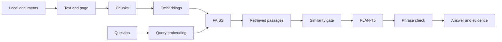

# Internal Knowledge RAG Assistant

A local retrieval-augmented question-answering prototype built with Python, Sentence Transformers, FAISS, FLAN-T5, FastAPI, and Streamlit. It searches documents, generates a short answer from retrieved passages, and shows the evidence that was used. The bundled knowledge base is **fictional**; it contains no employer documents.

## Features

- Reads UTF-8 `.txt`, Markdown `.md`, and text-based `.pdf` files. PDF page numbers are retained.
- Splits documents into overlapping chunks, embeds them with `all-MiniLM-L6-v2`, and ranks them with a FAISS inner-product index over normalized vectors.
- Uses `google/flan-t5-small` for an answer; below a configurable similarity threshold, it abstains before generation.
- Accepts a generated phrase only if it can be found in a retrieved passage. It returns that passage as `evidence` alongside the full list of retrieved `sources`.
- Offers an interactive Streamlit UI and a validated FastAPI `/ask` endpoint with Swagger documentation.
- Includes offline tests, a labelled synthetic evaluation set, and GitHub Actions for the offline test suite.

### Flow



This is a portfolio prototype. The phrase check proves only that the returned words occur in a passage; it **does not prove that the passage answers the question correctly**. Always inspect the evidence before using an answer.

## Repository layout

| Path | Purpose |
| --- | --- |
| `document_loader.py` | Extracts local text and PDF page provenance |
| `rag_engine.py` | Chunking, vector search, answer generation and conservative fallback |
| `api.py`, `streamlit_app.py` | REST API and local interface |
| `evaluation/questions.json`, `evaluate_retrieval.py` | 22 labelled questions and 12 out-of-scope probes |
| `tests/test_rag.py` | Offline ingestion, ranking, fallback and API tests |
| `data/sample_*` | Seven fictional example files, including a two-page PDF |
| `.github/workflows/tests.yml` | Offline tests on push and pull request |

## Install and run

Use Python 3.10–3.12. A CPU is sufficient. On Windows PowerShell, from the extracted project directory:

```powershell
py -3.12 -m venv .venv
.\.venv\Scripts\python.exe -m pip install torch==2.5.1 --index-url https://download.pytorch.org/whl/cpu
.\.venv\Scripts\python.exe -m pip install -r requirements.txt
.\.venv\Scripts\python.exe -m uvicorn api:app --reload
```

In a second PowerShell terminal:

```powershell
.\.venv\Scripts\python.exe -m streamlit run streamlit_app.py
```

Open `http://127.0.0.1:8000/docs` for the API or the Streamlit URL shown in the terminal. The embedding model downloads on first retrieval; FLAN-T5 downloads on the first answer that passes the relevance check.

On macOS/Linux, create and activate a virtual environment and run `python -m pip install -r requirements.txt`. For a CPU-only PyTorch installation on Linux, use the [official PyTorch CPU wheel instructions](https://pytorch.org/get-started/previous-versions/) before installing requirements. Then run `uvicorn api:app --reload` and `streamlit run streamlit_app.py` in separate terminals.

Try: **How should AI-generated information be verified?** The sample documents should produce a phrase from `sample_ai_guidelines.txt`. A question outside the documents should produce the fallback message.

## Test and evaluate

```bash
python -m pytest -q
python evaluate_retrieval.py
```

For a much smaller test-only environment, install `requirements-test.txt` instead. The tests use fake embedding and generation models and do not download the real models; the GitHub Actions workflow runs those tests. The evaluation script uses the real embedding model and calls the generator for answer and abstention checks.

The labelled questions are stored in `evaluation/questions.json`. They mix document-specific questions, page-specific PDF questions and out-of-scope questions. The script reports top-1 document match, top-1 evidence match, recall@3, MRR@3, how many positive prompts returned a copied passage, and abstention on out-of-scope prompts. This is a **small synthetic demonstration, not a general performance benchmark or human review of answer correctness**.

Local CPU check on the bundled sample set:

| Check | Result |
| --- | ---: |
| Offline tests | 10 passed |
| Correct document and page at rank 1 | 22 / 22 |
| Positive questions returning a copied phrase | 20 / 22 |
| Out-of-scope questions returning the fallback | 12 / 12 |

The two missed positive questions were conservatively rejected. Because the questions and documents were created together, these results should not be treated as an independent accuracy estimate.

## API response

`POST /ask` accepts `{"question": "...", "top_k": 3}`. The response contains:

- `answer`: a short copied phrase or `I could not find enough information in the provided documents.`
- `evidence`: one passage in which the answer's words were found, or `null`.
- `sources`: retrieved filenames, optional PDF page, chunk numbers, passage text and cosine similarity scores.

Similarity is a retrieval ranking score, **not** a probability that the answer is correct. `/health` checks the API process but does not load the models.

## Use your own documents privately

Set `RAG_DATA_DIR` to a directory of local `.txt`, `.md`, or text-based `.pdf` documents before starting the API. Example on PowerShell:

```powershell
$env:RAG_DATA_DIR='C:\path\to\private-docs'
.\.venv\Scripts\python.exe -m uvicorn api:app --reload
```

The default directory is `data/`. Git ignores any new files there except explicitly named `sample_*` files; keep confidential material **outside** the repository as well. The index is rebuilt on startup and remains in memory. The sample PDF has selectable text; scanned image PDFs require OCR, which this prototype does not provide.

## Limits and future work

- The heuristic threshold can reject a useful question or accept an irrelevant passage. It is calibrated only on the bundled synthetic set.
- Exact phrase matching reduces some unsupported outputs, but cannot verify meaning or prevent every hallucination.
- No authentication, authorization, multi-user document separation, persistent index, incremental ingestion, OCR, or production monitoring.
- A serious deployment would need a larger independently labelled set and manual assessment of factual grounding, privacy and access control.
